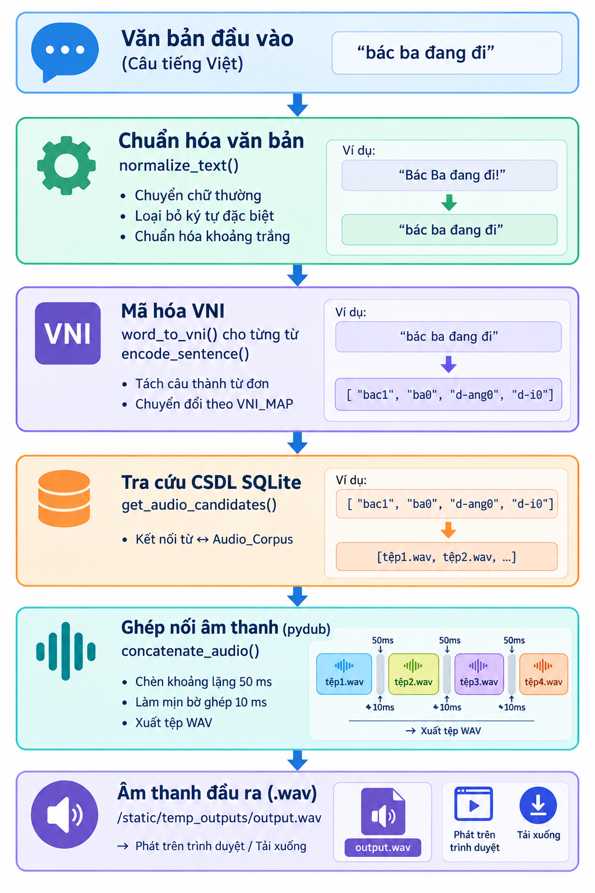
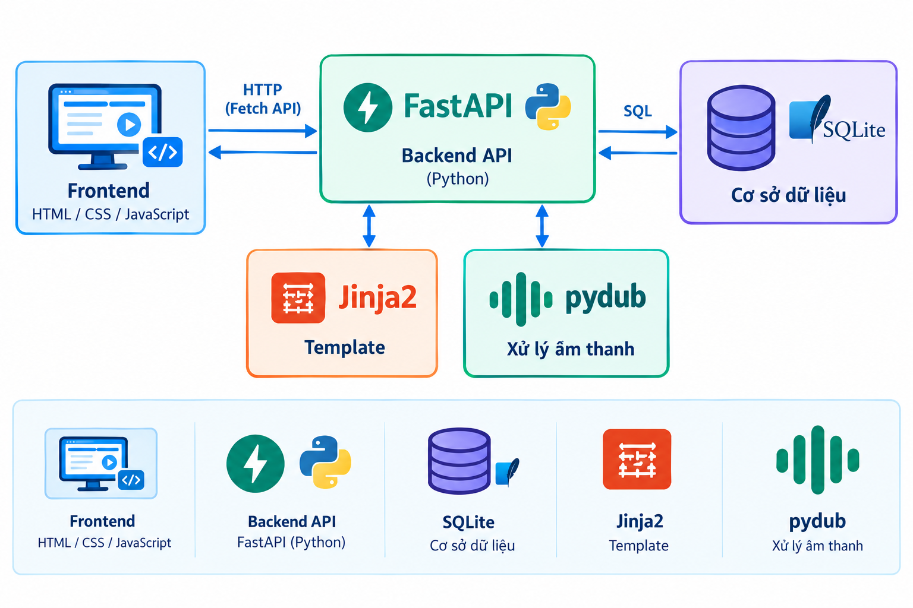
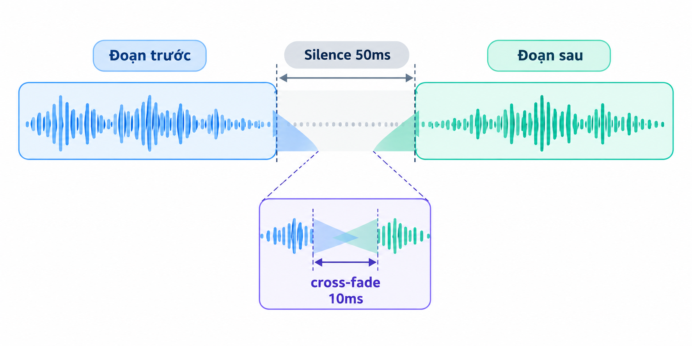
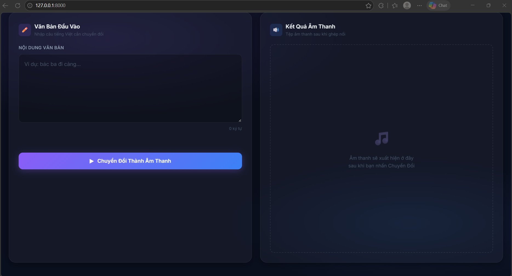
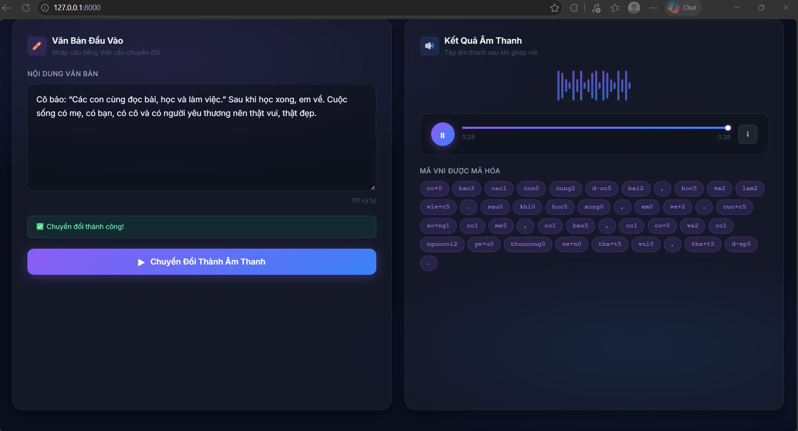

# TÓM TẮT

Đề tài trình bày việc xây dựng hệ thống chuyển đổi văn bản thành âm thanh cho tiếng Việt ở mức từ, sử dụng phương pháp tổng hợp ghép nối. Hệ thống nhận đầu vào là câu tiếng Việt, chuẩn hóa và mã hóa từng từ theo quy ước bộ gõ VNI, sau đó tra cứu cơ sở dữ liệu SQLite để tìm tệp âm thanh `.wav` tương ứng. Các tệp âm thanh được ghép nối bằng thư viện `pydub` với kỹ thuật chèn khoảng lặng 50 ms và làm mịn bờ ghép 10 ms nhằm tạo ra tín hiệu đầu ra liền mạch. Toàn bộ hệ thống được triển khai trên nền tảng Web với FastAPI, SQLite và HTML/CSS/JavaScript, cho phép người dùng nhập văn bản, chọn giọng đọc, nghe kết quả trực tiếp trên trình duyệt và tải xuống tệp `.wav`. Kết quả thực nghiệm cho thấy âm thanh tổng hợp rõ tiếng ở mức từ đơn, tuy nhiên ngữ điệu liên từ vẫn còn hạn chế so với cách phát âm liền mạch tự nhiên.

---

# 1. ĐẶT VẤN ĐỀ

## 1.1. Bối cảnh & Tầm quan trọng

Tổng hợp giọng nói từ văn bản (Text-to-Speech — TTS) là bài toán quan trọng trong lĩnh vực xử lý ngôn ngữ tự nhiên và đa phương tiện. Công nghệ TTS được ứng dụng rộng rãi trong nhiều lĩnh vực thực tế:

- **Hỗ trợ người khiếm thị**: đọc tài liệu, sách nói, tin tức tự động.
- **Trợ lý ảo & IoT**: tích hợp trong các thiết bị thông minh (Google Assistant [https://assistant.google.com/] hay Siri [https://www.apple.com/vn/siri/]) để giao tiếp bằng giọng nói.
- **Giáo dục**: hỗ trợ học phát âm ngoại ngữ, đọc bài cho trẻ em.
- **Truyền thông đa phương tiện**: tự động tạo lời bình cho video, podcast, nội dung kỹ thuật số.

Đối với tiếng Việt — ngôn ngữ có hệ thống thanh điệu phức tạp với 6 thanh (ngang, sắc, huyền, hỏi, ngã, nặng) — bài toán TTS đặt ra thách thức đặc biệt trong việc biểu diễn và xử lý dấu thanh khi mã hóa văn bản thành tín hiệu âm thanh.

## 1.2. Mục tiêu đề tài

Xây dựng hệ thống TTS tiếng Việt ở **mức từ** dựa trên bộ ngữ liệu thu âm do chính thành viên trong nhóm thực hiện. Cụ thể, hệ thống cần đạt được:

1. Thu âm và tổ chức bộ ngữ liệu âm thanh đơn từ tiếng Việt theo giọng đọc của thành viên nhóm.
2. Thiết kế cơ sở dữ liệu SQLite để quản lý quan hệ **từ — âm thanh — người đọc**, đồng thời lưu metadata mô tả các tệp âm thanh.
3. Xây dựng module mã hóa văn bản tiếng Việt sang hệ thống mã VNI phục vụ tra cứu.
4. Phát triển engine ghép nối âm thanh từ các file `.wav` đơn từ thành câu hoàn chỉnh.
5. Triển khai giao diện Web cho phép người dùng tương tác trực quan: nhập văn bản → nghe kết quả → tải xuống.

## 1.3. Phạm vi & Phương pháp tiếp cận

Hệ thống sử dụng phương pháp **tổng hợp ghép nối (concatenative synthesis)** — phương pháp cổ điển nhưng hiệu quả cho bài toán TTS mức từ. Ý tưởng cốt lõi: mỗi từ trong câu đầu vào được ánh xạ tới một tệp âm thanh `.wav` đã thu âm sẵn trong kho ngữ liệu, sau đó các tệp được ghép nối tuần tự có xử lý làm mịn biên.

**Phạm vi**:
- Ngữ liệu: tập hợp các từ đơn tiếng Việt thường dùng, thu âm bởi thành viên nhóm.
- Đầu vào: câu tiếng Việt (các từ đã có trong kho ngữ liệu).
- Đầu ra: tệp âm thanh `.wav` tổng hợp.
- Hệ thống hoạt động trên nền Web (trình duyệt), không yêu cầu cài đặt phần mềm phía người dùng.

---

# 2. PHƯƠNG PHÁP NGHIÊN CỨU

## 2.1. Ngữ liệu song song & Quy ước mã hóa VNI

Mục này trình bày nguồn ngữ liệu được sử dụng và cách chuẩn hóa dữ liệu văn bản
để liên kết với các tệp âm thanh tương ứng. Do hệ thống tra cứu audio thông qua
tên mã, việc thống nhất quy ước VNI giúp chuyển từ tiếng Việt có dấu thành khóa
tra cứu ổn định, đồng thời bảo toàn thông tin thanh điệu và vị trí ngắt câu.

### 2.1.1. Mô tả tập dữ liệu

Tập dữ liệu âm thanh bao gồm các tệp `.wav` thu âm đơn từ tiếng Việt theo giọng đọc của từng thành viên trong nhóm:

| Speaker ID | Tên thành viên    | Vai trò           |
|:----------:|:------------------|:-------------------|
| 1          | Nguyễn Thành Phát | Thu âm giọng đọc 1 |
| 2          | Võ Trường Nguyên  | Thu âm giọng đọc 2 |

Các tệp âm thanh được lưu tại thư mục `static/audio_corpus/` với định dạng WAV (Waveform Audio File Format), đảm bảo chất lượng gốc không nén.

### 2.1.2. Quy tắc mã hóa VNI

Để ánh xạ giữa từ tiếng Việt có dấu và tên tệp `.wav`, đề tài sử dụng hệ thống mã hóa dựa trên bộ gõ VNI với các quy tắc sau:

**Quy tắc dấu thanh** — thêm số biểu diễn thanh điệu vào cuối mã:

| Số | Thanh điệu | Ví dụ từ | Mã VNI |
|:--:|:-----------|:---------|:-------|
| 0  | Không dấu (ngang) | ba    | `ba0`   |
| 1  | Sắc        | bác      | `bac1`  |
| 2  | Huyền      | bè       | `be2`   |
| 3  | Hỏi        | cảng     | `cang3` |
| 4  | Ngã        | bãi      | `bai4`  |
| 5  | Nặng       | bạn      | `ban5`  |

**Quy tắc nguyên âm & phụ âm đặc biệt** — thay thế các ký tự không thuộc ASCII cơ bản:

| Ký tự gốc | Mã VNI | Ký tự gốc | Mã VNI |
|:----------:|:------:|:----------:|:------:|
| â          | `a+`   | ă          | `aa`   |
| ô          | `o+`   | ơ          | `oo`   |
| ê          | `e+`   | ư          | `uu`   |
| đ          | `d-`   |            |        |

**Quy tắc xử lý dấu câu** — dấu chấm và dấu phẩy không được chuyển thành mã
VNI có hậu tố thanh điệu. Chúng được giữ nguyên như các token riêng trong danh
sách mã hóa để bảo toàn vị trí ngắt câu và ngắt giữa các cụm từ:

| Dấu câu | Token sau mã hóa | Ý nghĩa xử lý |
|:-------:|:----------------:|:--------------|
| `,` | `,` | Giữ nguyên dấu phẩy, tạo khoảng lặng 150 ms giữa các từ hoặc cụm từ |
| `.` | `.` | Giữ nguyên dấu chấm, tạo khoảng lặng 350 ms khi kết thúc câu hoặc ngắt dài hơn |

**Ví dụ minh hoạ quá trình mã hóa**:

| Từ tiếng Việt | Phân tích              | Mã VNI   |
|:--------------|:-----------------------|:---------|
| đang          | đ → `d-`, ang, thanh 0 | `d-ang0` |
| cá            | c, a, thanh 1 (sắc)    | `ca1`    |
| bạn           | b, a, n, thanh 5 (nặng)| `ban5`   |
| đi            | đ → `d-`, i, thanh 0   | `d-i0`   |

Module `vni_encoder.py` cài đặt bảng tra `VNI_MAP` chứa đầy đủ ánh xạ cho 67 ký tự nguyên âm có dấu tiếng Việt (bao gồm 6 biến thể thanh điệu cho mỗi nguyên âm: a/á/à/ả/ã/ạ, â/ấ/ầ/ẩ/ẫ/ậ, …) và phụ âm `đ`.

## 2.2. Sơ đồ khối & Quy trình xử lý của hệ thống

Phần này mô tả kiến trúc xử lý từ khi hệ thống tiếp nhận văn bản đến khi tạo ra
tệp âm thanh đầu ra. Sơ đồ khối và các bước dưới đây làm rõ mối liên hệ giữa
module mã hóa VNI, cơ sở dữ liệu, bộ máy ghép nối audio và giao diện Web trong
toàn bộ quy trình TTS.

### 2.2.1. Sơ đồ khối



**Hình 2.1.** Sơ đồ khối quy trình chuyển văn bản tiếng Việt thành giọng nói.

### 2.2.2. Giải thích luồng xử lý

1. **Chuẩn hóa văn bản**: Câu đầu vào được chuyển về chữ thường, giữ lại dấu
   chấm và dấu phẩy, loại bỏ các ký tự đặc biệt khác bằng biểu thức chính quy
   `re.sub(r'[^\w\s,.]', '', text)`, sau đó chuẩn hóa nhiều khoảng trắng liên
   tiếp thành một.

2. **Mã hóa VNI**: Câu được tách thành các token từ và dấu câu bằng biểu thức
   `re.findall(r'\w+|[,.]', normalized)`. Với token là từ, hệ thống chuẩn hóa
   Unicode, duyệt từng ký tự qua bảng tra `VNI_MAP` để thay thế nguyên âm có
   dấu và phụ âm `đ`, cuối cùng gắn mã thanh điệu vào cuối. Với token là dấu
   chấm hoặc dấu phẩy, hệ thống giữ nguyên token đó.

3. **Tra cứu CSDL**: Với mỗi mã VNI, hệ thống thực hiện truy vấn JOIN giữa bảng `Words` và `Audio_Corpus` để tìm đường dẫn tệp `.wav`. Nếu hoàn toàn không có audio, từ đó bị bỏ qua khi ghép.

4. **Ghép nối âm thanh**: Sử dụng thư viện `pydub.AudioSegment` để đọc và ghép các tệp `.wav` tuần tự. Giữa hai từ liên tiếp được chèn khoảng lặng 50 ms (`AudioSegment.silent(duration=50)`) và áp dụng làm mịn bờ ghép 10 ms tại điểm ghép (`append(..., crossfade=10)`) nhằm giảm tiếng "click" và tạo chuyển tiếp mượt mà. File kết quả được xuất ra `static/temp_outputs/output.wav`.

5. **Trả kết quả**: Backend trả về JSON chứa URL tệp âm thanh, danh sách mã VNI đã mã hóa và danh sách từ không tìm thấy (`not_found`). Frontend nhận kết quả, hiển thị trình phát audio và chip mã VNI (đánh dấu đỏ cho từ thiếu audio).

### 2.2.3. Thành phần phần mềm



**Backend API — FastAPI (Python)**: Đóng vai trò là lớp trung gian xử lý toàn bộ yêu cầu HTTP từ phía người dùng. FastAPI tiếp nhận văn bản đầu vào, điều phối luồng xử lý TTS qua các module phụ trợ và cung cấp hai endpoint RESTful chính: `/api/tts` để tổng hợp âm thanh và `/api/speakers` để trả về danh sách giọng đọc.

**Cơ sở dữ liệu — SQLite**: Là thành phần lưu trữ trung tâm của hệ thống, SQLite quản lý toàn bộ dữ liệu từ vựng (bảng `Words`), thông tin người thu âm (bảng `Speakers`) và kho âm thanh cùng metadata mô tả tệp (bảng `Audio_Corpus`). Việc lựa chọn SQLite phù hợp với quy mô của đề tài nhờ tính nhẹ, không cần máy chủ riêng và dễ tích hợp với Python.

**Frontend — HTML/CSS/JavaScript**: Cung cấp giao diện Web tương tác trực tiếp trên trình duyệt mà không yêu cầu cài đặt thêm phần mềm phía người dùng. Giao diện gồm ô nhập văn bản, trình phát audio tùy chỉnh và bảng hiển thị mã VNI — toàn bộ được xây dựng bằng HTML/CSS/JavaScript thuần, giao tiếp với backend qua Fetch API.

**Xử lý âm thanh — pydub**: Thư viện Python chịu trách nhiệm toàn bộ quá trình xử lý tín hiệu âm thanh: đọc các tệp `.wav` từ kho ngữ liệu, ghép nối tuần tự theo thứ tự từ trong câu, chèn khoảng lặng 50 ms giữa các từ và áp dụng làm mịn 10 ms tại điểm ghép, sau đó xuất kết quả thành tệp `.wav` cuối cùng.

**Template — Jinja2**: Đảm nhận việc render trang HTML động phía server. Jinja2 cho phép nhúng dữ liệu từ CSDL (danh sách bảng, bản ghi, thống kê) vào các template HTML trước khi gửi về trình duyệt.

## 2.3. Quản lý và Lưu trữ CSDL

Để quản lý văn bản – âm thanh theo từ và theo người thu âm, hệ thống sử
dụng cơ sở dữ liệu quan hệ SQLite làm lớp lưu trữ trung tâm. Phần này trình bày
lược đồ quan hệ, vai trò của từng bảng và cách các khóa liên kết hỗ trợ tra cứu
đúng tệp audio theo mã VNI và speaker được lựa chọn.

### 2.3.1. Lược đồ quan hệ

```
┌─────────────┐       ┌───────────────────┐       ┌──────────────┐
│   Words     │       │   Audio_Corpus    │       │   Speakers   │
├─────────────┤       ├───────────────────┤       ├──────────────┤
│ PK word_id  │──1:N──│ FK word_id        │  N:1──│ PK speaker_id│
│ original_word│      │ FK speaker_id     │       │ speaker_name │
│ vni_code    │       │ PK audio_id       │       └──────────────┘
└─────────────┘       │ file_path         │
                      │ duration_ms       │
                      │ pitch_avg         │
                      │ energy_avg        │
                      └───────────────────┘

```

### 2.3.2. Bảng Words (Danh mục từ vựng)

Lưu trữ từ tiếng Việt gốc và mã VNI tương ứng. Cột `vni_code` có ràng buộc `UNIQUE` để đảm bảo mỗi từ chỉ có duy nhất một mã VNI.

```sql
CREATE TABLE IF NOT EXISTS Words (
    word_id       INTEGER PRIMARY KEY AUTOINCREMENT,
    original_word TEXT    NOT NULL,
    vni_code      TEXT    UNIQUE NOT NULL
);
```

### 2.3.3. Bảng Speakers (Thành viên thu âm)

Lưu danh sách các thành viên đã thu âm.

```sql
CREATE TABLE IF NOT EXISTS Speakers (
    speaker_id   INTEGER PRIMARY KEY AUTOINCREMENT,
    speaker_name TEXT    NOT NULL
);
```

### 2.3.4. Bảng Audio_Corpus (Kho âm thanh & Đặc trưng)

Bảng trung tâm liên kết từ vựng với tệp âm thanh thông qua khóa ngoại `word_id` (tham chiếu `Words`) và `speaker_id` (tham chiếu `Speakers`).

```sql
CREATE TABLE IF NOT EXISTS Audio_Corpus (
    audio_id    INTEGER PRIMARY KEY AUTOINCREMENT,
    word_id     INTEGER NOT NULL,
    speaker_id  INTEGER NOT NULL,
    file_path   TEXT    NOT NULL,
    duration_ms REAL,
    pitch_avg   REAL,
    energy_avg  REAL,
    FOREIGN KEY (word_id)    REFERENCES Words(word_id),
    FOREIGN KEY (speaker_id) REFERENCES Speakers(speaker_id)
);
```


## 2.4. Trích rút đặc trưng & Thuật toán ghép nối âm thanh

Sau khi audio được tra cứu từ cơ sở dữ liệu, hệ thống cần mô tả và kết hợp các
đoạn WAV để tạo thành tín hiệu đầu ra. Phần này phân biệt metadata dùng để mô tả
corpus với dữ liệu waveform được ghép trực tiếp, đồng thời trình bày các thao
tác chèn khoảng lặng và làm mịn tại ranh giới giữa các đoạn âm thanh.

### 2.4.1. Metadata mô tả âm thanh

Mỗi tệp `.wav` trong kho ngữ liệu có thể được mô tả bằng các metadata sau, lưu trong bảng `Audio_Corpus`. Các giá trị này giúp thống kê, kiểm tra và phục vụ khả năng mở rộng hệ thống; engine hiện tại vẫn sử dụng trực tiếp waveform của tệp WAV gốc để ghép nối.

| Đặc trưng | Trường CSDL | Đơn vị | Ý nghĩa |
|:-----------|:------------|:-------|:---------|
| **Thời lượng** (Duration) | `duration_ms` | ms | Metadata về độ dài thời gian phát của đoạn âm thanh |
| **Độ cao trung bình** (Pitch) | `pitch_avg` | Hz | Metadata mô tả tần số dao động trung bình của tín hiệu, phản ánh cao/thấp giọng |
| **Năng lượng trung bình** (Energy) | `energy_avg` | dBFS/RMS | Metadata mô tả cường độ tín hiệu trung bình, phản ánh to/nhỏ giọng |

Trong phiên bản hiện tại, `pitch_avg` và `energy_avg` không điều khiển quá trình
ghép nối và không được dùng để biến đổi waveform. Chúng chỉ được lưu như metadata
của từng tệp audio để mô tả corpus, hỗ trợ phân tích chất lượng bản ghi và làm cơ
sở cho các hướng mở rộng như lựa chọn đoạn tương thích hoặc điều chỉnh prosody.

### 2.4.2. Thuật toán ghép nối âm thanh

Quy trình ghép nối được cài đặt trong hàm `concatenate_audio()` của module `tts_engine.py`:

```python
final_audio = AudioSegment.empty()
silence = AudioSegment.silent(duration=50)  # Khoảng lặng 50ms

for vni in vni_codes:
    # Bước 1: Tra cứu tệp .wav qua CSDL (ưu tiên speaker → fallback)
    selected_path = ...  # get_audio_candidates(vni, speaker_id)
    
    # Bước 2: Đọc tệp .wav
    segment = AudioSegment.from_wav(selected_path)
    
    # Bước 3: Ghép nối
    if len(final_audio) == 0:
        final_audio = segment           # Từ đầu tiên
    else:
        # Chèn khoảng lặng 50ms + cross-fade 10ms
        final_audio = final_audio.append(silence, crossfade=10)
        final_audio = final_audio.append(segment, crossfade=10)

# Bước 4: Xuất kết quả
final_audio.export("static/temp_outputs/output.wav", format="wav")
```

**Giải thích các kỹ thuật xử lý**:

- **Chèn khoảng lặng (Silence Insertion — 50 ms)**: Mô phỏng khoảng nghỉ tự nhiên giữa các từ khi nói. Giá trị 50 ms được chọn vì đủ ngắn để không gây cảm giác ngắt quãng, nhưng đủ dài để phân biệt ranh giới từ.

- **Làm mịn bờ ghép (Cross-fading — 10 ms)**: Tại điểm nối giữa hai đoạn audio, kỹ thuật cross-fade tạo vùng chuyển tiếp mượt bằng cách giảm dần biên độ đoạn trước (fade-out) đồng thời tăng dần biên độ đoạn sau (fade-in). Điều này loại bỏ hiện tượng "click" hoặc tiếng giật do sự khác biệt biên độ đột ngột tại điểm ghép.



---

# 3. KẾT QUẢ VÀ THẢO LUẬN

## 3.1. Giao diện và Demo chương trình

Phần này trình bày giao diện người dùng và kết quả chạy thử hệ thống TTS trên
môi trường Web. Thông qua quy trình demo, người dùng có thể nhập một từ hoặc
một chuỗi từ tiếng Việt, lựa chọn giọng đọc, theo dõi quá trình chuyển đổi và
nghe hoặc tải xuống tệp âm thanh đầu ra. Nội dung minh họa tập trung kiểm tra
toàn bộ luồng xử lý đã trình bày ở phần trước, từ tiếp nhận văn bản, mã hóa VNI,
tra cứu audio trong cơ sở dữ liệu đến ghép nối và phát tín hiệu âm thanh kết quả.

### 3.1.1. Trang chủ — Giao diện tổng hợp TTS



*Hình 1: Giao diện ban đầu của hệ thống TTS tiếng Việt*

Hệ thống được triển khai dưới dạng ứng dụng Web và truy cập qua trình duyệt tại địa chỉ máy chủ cục bộ. Giao diện sử dụng bố cục hai cột trên nền tối, giúp người dùng đồng thời theo dõi nội dung đầu vào và kết quả xử lý:

- **Panel trái — Văn bản đầu vào**: gồm tiêu đề chức năng, ô nhập văn bản tiếng Việt và bộ đếm số ký tự theo thời gian thực. Khi chưa nhập nội dung, ô văn bản hiển thị gợi ý mẫu “Ví dụ: bác ba đi cảng...”. Bên dưới là nút **Chuyển Đổi Thành Âm Thanh**, dùng để bắt đầu quá trình tổng hợp.

- **Panel phải — Kết quả âm thanh**: ở trạng thái ban đầu, khu vực này hiển thị biểu tượng âm nhạc và thông báo cho biết âm thanh sẽ xuất hiện sau khi người dùng nhấn nút chuyển đổi. Cách bố trí này giúp phân biệt rõ trạng thái chưa có kết quả với trạng thái đã tổng hợp xong.

### 3.1.2. Quá trình tổng hợp âm thanh



*Hình 2: Giao diện sau khi tổng hợp âm thanh thành công*

Quy trình demo được thực hiện với câu:

> “Cô bảo: Các con cùng đọc bài, học và làm việc. Sau khi học xong, em về. Cuộc sống có mẹ, có bạn, có cô và có người yêu thương nên thật vui, thật đẹp.”

Các bước thực hiện và kết quả quan sát được như sau:

1. Người dùng nhập câu tiếng Việt vào ô **Nội dung văn bản**. Bộ đếm ký tự cập nhật theo nội dung đã nhập.
2. Người dùng nhấn nút **Chuyển Đổi Thành Âm Thanh**. Frontend gửi yêu cầu `POST /api/tts` với nội dung văn bản và mã giọng đọc được chọn.
3. Backend chuẩn hóa câu, mã hóa từng từ sang mã VNI, tra cứu các tệp `.wav` tương ứng trong SQLite và ghép nối các đoạn âm thanh.
4. Sau khi xử lý hoàn tất, panel bên trái hiển thị thông báo màu xanh **“Chuyển đổi thành công!”**.
5. Panel bên phải hiển thị hiệu ứng dạng sóng, trình phát âm thanh với nút phát/tạm dừng, thanh tiến trình, thời lượng và nút tải tệp kết quả. Trong hình minh họa, thời lượng bản ghi là khoảng 28 giây.
6. Danh sách **Mã VNI được mã hóa** được hiển thị dưới dạng các chip riêng biệt. Danh sách này cho phép kiểm tra trực quan kết quả chuyển đổi; dấu phẩy và dấu chấm cũng được giữ lại như các token riêng để thể hiện vị trí ngắt nghỉ trong câu.

Demo cho thấy hệ thống thực hiện đầy đủ chu trình từ nhập văn bản, mã hóa VNI, tra cứu dữ liệu, ghép nối audio đến phát kết quả ngay trên trình duyệt.

## 3.2. Đánh giá kết quả chất lượng âm thanh

Phần này đánh giá kết quả tổng hợp dựa trên các mẫu đầu vào đại diện, gồm câu
chỉ chứa những từ có trong corpus và câu có từ không tìm thấy. Các tiêu chí được
quan sát gồm khả năng tra cứu, thời lượng tệp đầu ra, độ rõ của từng từ và mức
độ liền mạch tại các điểm ghép; qua đó làm rõ hiệu quả cũng như giới hạn của
phương pháp tổng hợp ghép nối ở mức từ.

### 3.2.1. Bảng đánh giá

| Mẫu kiểm thử | Số từ | Từ tìm thấy | Từ không tìm thấy | Thời lượng đầu ra | Nhận xét |
|:-------------|------:|------------:|------------------:|-------------------:|:---------|
| `bác ba đi cảng` | 4 | 4 | 0 | khoảng 3.000 ms | Các từ được phát âm rõ; audio đầu ra được tạo thành công |
| Câu demo dài | 52 | 52 | 0 | khoảng 28.000 ms | Tạo được câu dài; có thể nghe thấy ranh giới ghép giữa các từ |
| Câu chứa từ ngoài corpus, ví dụ `bác xyz` | 2 | 1 | 1 | phụ thuộc vào từ tìm thấy | Hệ thống cảnh báo hoặc bỏ qua từ không có trong corpus; vẫn ghép các từ tìm thấy |


### 3.2.2. Phân tích ưu/nhược điểm

**Ưu điểm**:
- Chất lượng từng từ đơn **cao và tự nhiên** vì sử dụng trực tiếp audio thu âm gốc, không qua mô hình sinh tổng hợp.
- Hệ thống **dễ mở rộng**: chỉ cần thu âm thêm từ mới, thêm vào CSDL là có thể sử dụng ngay.
- **Kiến trúc module rõ ràng**: tách biệt encoder, database, engine và API server — dễ bảo trì và phát triển.

**Nhược điểm**:
- **Ngữ điệu liên từ thiếu tự nhiên**: phương pháp ghép nối từ đơn không thể mô phỏng sự biến đổi pitch, cường độ và nhịp điệu giữa các từ trong câu hoàn chỉnh.
- **Phụ thuộc vào kho ngữ liệu**: hệ thống chỉ phát âm được những từ đã có trong CSDL; từ mới hoàn toàn sẽ bị bỏ qua.Cross-fade 10 ms giúp giảm hiện tượng "click" nhưng **chưa xử lý được sự chênh lệch pitch và energy** giữa hai từ liền kề từ các lượt thu âm khác nhau.
- Chưa xử lý được **từ ghép, từ đồng âm** và các trường hợp đặc biệt trong tiếng Việt.

---

# 4. KẾT LUẬN VÀ HÀM Ý QUẢN TRỊ

## 4.1. Tóm tắt kết quả

Đề tài đã hoàn thành việc xây dựng hệ thống TTS tiếng Việt mức từ sử dụng phương pháp tổng hợp ghép nối, đáp ứng đầy đủ các yêu cầu đặt ra: 
- Thu âm và tổ chức bộ ngữ liệu âm thanh đơn từ theo quy ước mã hóa VNI; 
- Thiết kế cơ sở dữ liệu SQLite gồm 3 bảng quan hệ quản lý từ vựng, giọng đọc và kho âm thanh; 
- Xây dựng module mã hóa VNI hỗ trợ đầy đủ 6 thanh điệu và 7 ký tự đặc biệt tiếng Việt; 
- Cài đặt engine ghép nối với kỹ thuật silence insertion và cross-fade; 
- Triển khai giao diện Web hoàn chỉnh trên nền FastAPI với trình phát audio tùy chỉnh và trang quản trị CSDL. 
Kết quả cho thấy âm thanh tổng hợp rõ ràng ở mức từ đơn, hệ thống phản hồi nhanh và giao diện trực quan.

## 4.2. Hạn chế & Hướng phát triển

- **Xử lý ngữ điệu liên từ**: Áp dụng kỹ thuật prosody modification (TD-PSOLA, WSOLA) để điều chỉnh pitch và duration giữa các từ, tạo ngữ điệu câu tự nhiên hơn.
- **Mở rộng ngữ liệu**: Tăng số lượng từ thu âm, bổ sung thêm giọng đọc đa dạng (nam/nữ, vùng miền).
- **TTS mức âm vị (phoneme-level)**: Chuyển từ ghép nối mức từ sang mức âm vị/biphone để xử lý được từ hoàn toàn mới chưa thu âm.
- **Tích hợp trích xuất đặc trưng tự động**: Sử dụng thư viện `librosa` để tự động tính duration, pitch, energy khi import audio mới.
- **Tối ưu cross-fade theo đặc trưng**: Điều chỉnh tham số cross-fade dựa trên pitch và energy hai đoạn liền kề để ghép mượt hơn.

## 4.3. Phạm vi sử dụng trí tuệ nhân tạo

Trong quá trình thực hiện đề tài, nhóm có sử dụng công cụ AI hội thoại như một
trợ lý kỹ thuật. Việc sử dụng AI nhằm hỗ trợ quá trình nghiên cứu và phát triển,
không thay thế vai trò thiết kế, triển khai, kiểm thử và chịu trách nhiệm của các
thành viên trong nhóm.

### 4.3.1. Các nội dung có sử dụng AI

- **Tìm hiểu và giải thích kiến thức**: yêu cầu AI giải thích các khái niệm liên
  quan đến TTS, mã hóa VNI, SQLite, FastAPI, `pydub` và cách tổ chức một ứng dụng
  Web.
- **Gợi ý thiết kế**: tham khảo gợi ý về cấu trúc thư mục, thiết kế các bảng
  `Words`, `Speakers`, `Audio_Corpus`, quy trình tra cứu audio và luồng xử lý
  từ văn bản đến tệp âm thanh.
- **Hỗ trợ lập trình**: nhờ AI gợi ý hoặc rà soát một số đoạn mã Python,
  FastAPI, JavaScript và SQL, chẳng hạn hàm mã hóa VNI, hàm chuyển từng chữ số
  thành chữ tiếng Việt và logic ghép nối tệp WAV.
- **Hỗ trợ tìm lỗi**: cung cấp thông báo lỗi và kết quả kiểm thử cho AI để nhận
  diện nguyên nhân có thể xảy ra, sau đó nhóm tự kiểm tra lại trên mã nguồn,
  cơ sở dữ liệu và các tệp audio thực tế.
- **Hỗ trợ biên tập báo cáo**: tham khảo cách diễn đạt, sắp xếp nội dung và
  trình bày các kết quả kỹ thuật trong báo cáo.

### 4.3.2. Các nội dung do nhóm tự thực hiện

- Xác định đề tài, mục tiêu, phạm vi và phương pháp tổng hợp ghép nối.
- Thu âm, chuẩn bị, đặt tên và kiểm tra bộ ngữ liệu tiếng Việt.
- Lựa chọn các công nghệ sử dụng, xây dựng cơ sở dữ liệu và tích hợp các module
  của hệ thống.
- Chạy thử ứng dụng, kiểm tra việc mã hóa VNI, tra cứu tệp audio, ghép nối và
  phát kết quả trên giao diện Web.
- Đánh giá kết quả, phân tích hạn chế và đề xuất hướng phát triển.

### 4.3.3. Nguyên tắc kiểm chứng

Các nội dung do AI gợi ý đều được nhóm đọc hiểu, chỉnh sửa và kiểm chứng trước
khi sử dụng. Nhóm không đưa thông tin cá nhân, tài khoản, mật khẩu hoặc dữ liệu
nhạy cảm vào công cụ AI. Mã nguồn cuối cùng, dữ liệu âm thanh, kết quả thực nghiệm
và các nhận xét trong báo cáo thuộc trách nhiệm của nhóm.

---

# Tài liệu tham khảo

1. Taylor, P. (2009). *Text-to-Speech Synthesis*. Cambridge University Press.
2. Dutoit, T. (1997). *An Introduction to Text-to-Speech Synthesis*. Kluwer Academic Publishers.
3. FastAPI Documentation. https://fastapi.tiangolo.com/
4. pydub — Manipulate audio with a simple and easy high level interface. https://github.com/jiaaro/pydub
5. SQLite Documentation. https://www.sqlite.org/docs.html
6. Unicode Consortium. *The Unicode Standard — Vietnamese characters*. https://unicode.org/
7. Nguyễn Hữu Quỳnh. (2001). *Tiếng Việt hiện đại — Ngữ âm, Ngữ pháp, Phong cách*. NXB Giáo dục.

---

# Phụ lục

## A. Hàm mã hóa VNI (`vni_encoder.py`)

### Bảng tra VNI_MAP (trích)

```python
VNI_MAP = {
    # Nguyên âm a (6 thanh điệu)
    'a': ('a', '0'), 'á': ('a', '1'), 'à': ('a', '2'),
    'ả': ('a', '3'), 'ã': ('a', '4'), 'ạ': ('a', '5'),
    # Nguyên âm â (6 thanh điệu)
    'â': ('a+', '0'), 'ấ': ('a+', '1'), 'ầ': ('a+', '2'),
    'ẩ': ('a+', '3'), 'ẫ': ('a+', '4'), 'ậ': ('a+', '5'),
    # ... (tổng cộng 67 ánh xạ cho tất cả nguyên âm tiếng Việt)
    'đ': ('d-', '0')
}
```

### Hàm chuyển đổi từ đơn

```python
def word_to_vni(word: str) -> str:
    word = unicodedata.normalize('NFC', word.lower())
    tone = '0'
    vni_word = ""
    for char in word:
        if char in VNI_MAP:
            base, char_tone = VNI_MAP[char]
            vni_word += base
            if char_tone != '0':
                tone = char_tone
        else:
            vni_word += char
    return vni_word + tone
```

## B. Hàm ghép nối audio (`tts_engine.py`)

```python
def concatenate_audio(vni_codes, speaker_id):
    final_audio = AudioSegment.empty()
    silence = AudioSegment.silent(duration=50)
    not_found = []
    fallback_used = []

    for vni in vni_codes:
        # Tra cứu CSDL: ưu tiên speaker → fallback speaker khác
        for candidate in database.get_audio_candidates(vni, speaker_id):
            full_path = os.path.join(BASE_DIR, candidate["file_path"])
            if os.path.exists(full_path):
                selected_path = full_path
                break

        if selected_path is None:
            not_found.append(vni)
            continue

        segment = AudioSegment.from_wav(selected_path)

        if len(final_audio) == 0:
            final_audio = segment
        else:
            # Chèn silence 50ms + cross-fade 10ms
            final_audio = final_audio.append(silence, crossfade=10)
            final_audio = final_audio.append(segment, crossfade=10)

    if len(final_audio) > 0:
        final_audio.export(OUTPUT_FILE, format="wav")

    return "/static/temp_outputs/output.wav", not_found, fallback_used
```

## C. Cấu trúc API Endpoints

| Method | Endpoint          | Mô tả                           | Request Body / Params              | Response                                 |
|:-------|:------------------|:---------------------------------|:-----------------------------------|:-----------------------------------------|
| GET    | `/`               | Trang chủ giao diện TTS          | —                                  | HTML (index.html)                        |
| GET    | `/database`       | Trang quản trị CSDL              | `?table=Words`                     | HTML (database.html)                     |
| POST   | `/database/words` | Thêm từ mới vào bảng Words       | Form: `original_word`, `vni_code`  | Redirect → `/database?table=Words`       |
| POST   | `/database/audio` | Thêm audio vào Audio_Corpus      | Form: `word_id`, `speaker_id`, ... | Redirect → `/database?table=Audio_Corpus`|
| GET    | `/api/speakers`   | Danh sách giọng đọc              | —                                  | `{"speakers": [...]}`                    |
| POST   | `/api/tts`        | Tổng hợp âm thanh từ văn bản     | JSON: `{"text": "...", "speaker_id": 1}` | `{"audio_url": "...", "vni_codes": [...], "not_found": [...], "fallback_used": [...]}` |
